<!-- README from framework/templates/README-template.md -->

# 🚀 Flask Secrets

A small Flask website from Day 61 of Udemy's "100 Days of Code: The Complete Python Pro Bootcamp": a login form built with Flask-WTF that guards a secret page. It is written for course participants who want to compare solutions and for visitors looking for ideas.

## 📚 Table of Contents

- [Overview](#-overview)
- [Requirements](#-requirements)
- [Setup](#-setup)
- [Run](#-run)
- [Tests](#-tests)
- [License](#-license)
- [Links](#-links)
- [Appendix: Project documents](#-appendix-project-documents)

## 🧭 Overview

The site asks for an email and a password. The demo account of the lecture (`admin@email.com` / `12345678`) shows the secret page; any other input shows an "access denied" page. The password is a fixed lecture value for learning, not a real credential.

| Folder | Purpose |
| --- | --- |
| `src/flask_secrets/` | The application: `constants.py` and the layers `domain` (the credentials rule), `application` (the `authenticate_user` use case) and `presentation` (routes `home` and `login`, the `LoginForm`, templates) |
| `tests/` | pytest tests |
| `docs/` | Project documents, screenshots (`docs/images/`) and the plan |

The [wiki][wiki] explains what each lecture step taught, in English, Danish and Bahasa Malaysia. Its pages are in `docs/wiki/` and are published to the git host when they are merged.

### Lecture steps

Every screenshot is taken in a Docker container by `scripts/capture_screenshot.sh`, so it never uses the host desktop.

**Step 1: the login route.** A route named `login` renders `login.html`.

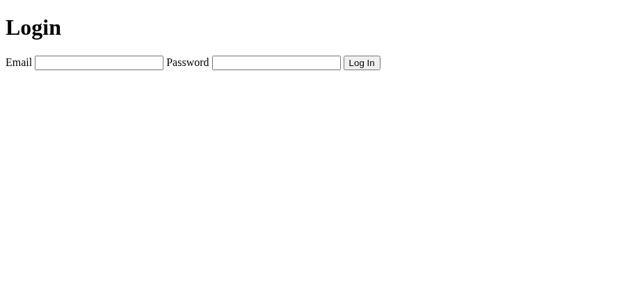

**Step 2: a login form with Flask-WTF.** `LoginForm` has an email and a password field of size 30 and a CSRF token.

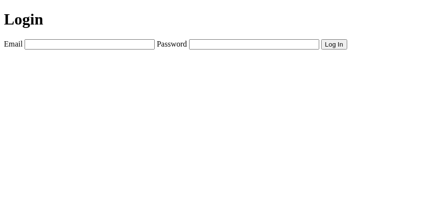

**Step 3: five code improvements.** A `PasswordField` hides the typed text, labels use the `label` keyword, the form action uses `url_for`, a table lays out the fields and a `SubmitField` renders the button.

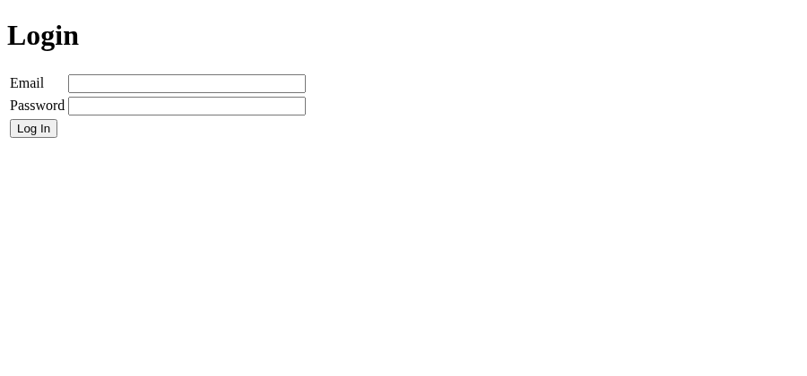

**Step 4: required fields.** `DataRequired` validators, `novalidate` on the form (so every browser shows our errors) and `validate_on_submit()` in the route. Submitting empty fields shows an error for each.

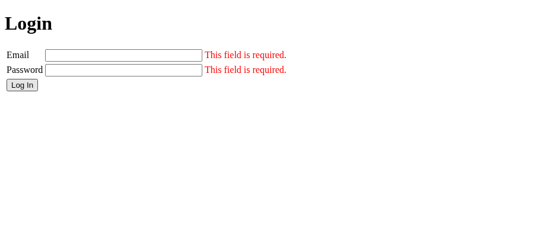

**Step 5: email and length validation.** The `Email` validator (it needs the `email-validator` package) and `Length(min=8)` for the password.

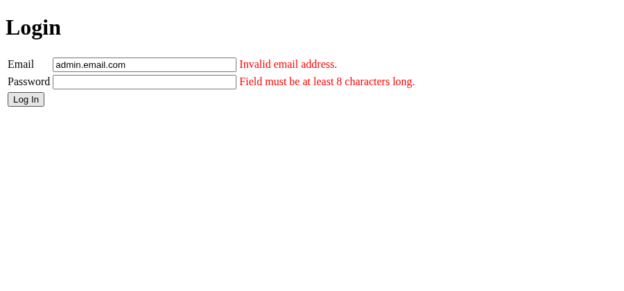

**Step 6: check the credentials.** The valid demo account (`admin@email.com` / `12345678`) gets `success.html`; everything else gets `denied.html`.


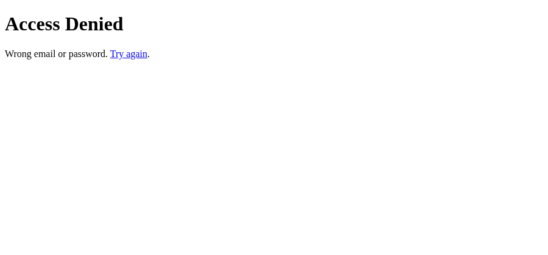

**Step 7: template inheritance.** `base.html` has `title` and `content` blocks; the success and denied pages extend it.

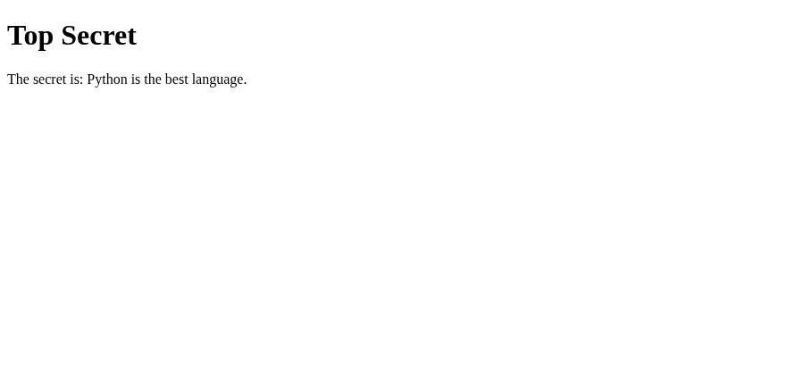

**Step 8: super blocks.** `base.html` has a `styling` block (purple background). The denied page calls `{{ super() }}` and adds a red heading. (This step is replaced by Bootstrap in step 9; the screenshot shows how it looked.)

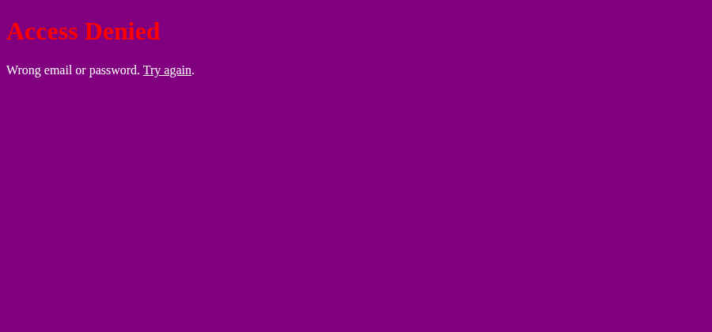

**Step 9: Bootstrap-Flask.** `Bootstrap5(app)` is initialised, `base.html` loads the Bootstrap CSS and every page extends it. The Bootstrap files are served from this site, not from a CDN.

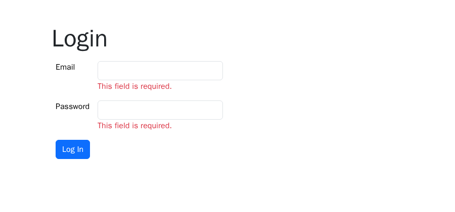

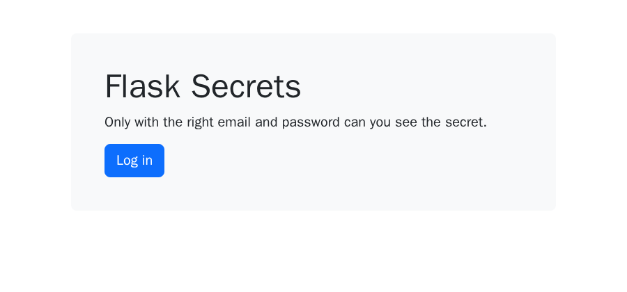

**Step 10: `render_form`.** One line, `render_form(form)`, replaces the hand-written form and also shows the validation errors.

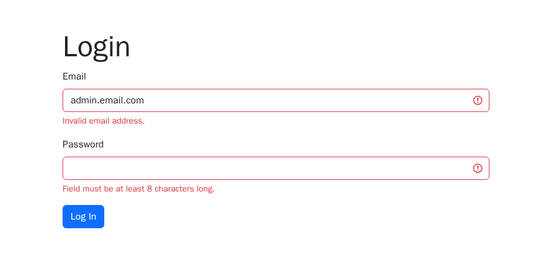

## 📋 Requirements

- Python 3.13 or newer.
- Runtime packages (installed by `pip`): Flask, Flask-WTF (forms and CSRF), email-validator (email check) and Bootstrap-Flask (layout).
- pytest, only for the tests (the `dev` extra).
- Doxygen, optional, to build the API documentation.

## 🛠️ Setup

Create and use a local virtual environment named `.venv`, then upgrade pip and install the project.

Windows (PowerShell):

```powershell
python -m venv .venv
.venv\Scripts\Activate.ps1
python -m pip install --upgrade pip
python -m pip install -e ".[dev]"
```

macOS and Linux:

```bash
python3 -m venv .venv
source .venv/bin/activate
python -m pip install --upgrade pip
python -m pip install -e ".[dev]"
```

## ▶️ Run

```bash
python -m flask_secrets.presentation.main
```

Open http://127.0.0.1:5000/ in a browser. Set the `SECRET_KEY` environment variable to use your own CSRF key.

## 🧪 Tests

```bash
python -m pytest
```

## 📄 License

See [LICENSE][license].

## 🔗 Links

- [Repository][repository]
- [Documentation][documentation]
- [Issue tracker][issues]

## 📎 Appendix: Project documents

| Document | What it tells you |
| --- | --- |
| [AGENTS.md][agents] | The rules AI agents follow in this repository |
| [Business Case][BC-001] | Why the project exists, its scope and success criteria |
| [Stakeholder Analysis][SA-001] | Who is involved; the stakeholder IDs used for owners and reviewers |
| [Project Plan][PP-001] | The gateways and their schedule |
| [Milestones][milestones] | One document per gateway: Go/No-Go criteria and tasks |
| [Artifact registry][registry] | Where each artifact type lives, the next version, the PO language and domain |
| [Traceability matrix][TM-001] | How the artifacts link and when each was last reviewed |
| [Framework README][framework-readme] | The framework this project uses |
| [Framework changelog][framework-changelog] | What changed in each framework release |

---

[license]: ./LICENSE
[repository]: https://git.tirsystem.com/Tirsvad-Udemy-100-days-of-code/061-flask-secrets
[wiki]: https://git.tirsystem.com/Tirsvad-Udemy-100-days-of-code/061-flask-secrets/wiki
[documentation]: https://git.tirsystem.com/Tirsvad-Udemy-100-days-of-code/061-flask-secrets/wiki
[issues]: https://git.tirsystem.com/Tirsvad-Udemy-100-days-of-code/061-flask-secrets/issues
[agents]: ./AGENTS.md
[BC-001]: ./docs/business-case.md
[SA-001]: ./docs/stakeholder-analysis.md
[PP-001]: ./docs/project-plan.md
[milestones]: ./docs/milestones/
[registry]: ./docs/artifact-registry.md
[TM-001]: ./docs/sqa/traceability-matrix.md
[framework-readme]: ./framework/README.md
[framework-changelog]: ./framework/CHANGELOG.md
