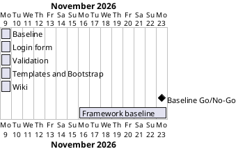

# Project Plan

## Metadata
| Key | Value |
| --- | --- |
| ID | PP-001 |
| CrossReference | [BC-001], [SA-001], [MIL-001], [MIL-002], [MIL-003], [MIL-004], [MIL-005], [MIL-006] |
| Language | en |
| Domain | education |

## Version History
| Date | Status | Author | Reviewer | Change | Commit |
| --- | --- | --- | --- | --- | --- |
| 2026-11-09 | Deprecated | Jens Tirsvad Nielsen | AI as stand-in for S01 | Initial version for the Day 61 Flask Secrets project | [1c70baa] |
| 2026-11-16 | Accepted | Jens Tirsvad Nielsen | AI as stand-in for S01 | Added the baseline gateway G6 (MIL-006) with its schedule row, scope coverage, dependency, risk and Gantt entries; recorded the move of the end date, the domain, the open pull request #31, the course demo values and the Dockerfile task in the Planning Assumptions and Open Issues; filled the empty milestone column of MIL-001 to MIL-005 with the links to the milestones on the git host; set the domain to education; reviewed in autonomous mode, not independent | pending |

---

## Purpose

Schedules the five phases (gateways) and, since the baseline gateway [MIL-006], a sixth that deliver the Day 61 Flask Secrets project in order, one pull request per phase. [BC-001] sets no deadline, so the plan sets the order and the dependencies.

## Planning Assumptions

- Start date 2026-11-09; end date 2026-11-09. The constraint is that [BC-001] sets no deadline and requires one reviewed pull request per milestone (source: the Product Owner's first prompt).
- The work is done in one autonomous run after S01 accepts this plan; all windows therefore fall on 2026-11-09 and are ordered, not time-boxed.
- Each phase is a branch and a pull request that closes its issues.
- Screenshots are taken in a Docker container, never on the host desktop.
- The baseline gateway G6 (MIL-006) starts 2026-11-16 and ends 2026-11-23, one week (source: [BC-001], Constraints). It brings the finished project to the baseline of the framework, a decision of S01. The decision dates of the earlier gateways stay as they were, so the end date of the plan moves from 2026-11-09 to 2026-11-23.
- For MIL-006 S01 has authorised the assistant to commit, push, open the pull request and merge it, and the review is done by an AI stand-in for S01 (source: [BC-001], Constraints and Risks).
- The PO language is English; the domain is IT until [MIL-006] and education since.

## Gateway Schedule

| Gateway | Document | Window | Decision date | Owner | Stories | Main deliverable | Milestone |
| --- | --- | --- | --- | --- | --- | --- | --- |
| Project baseline and repository | [MIL-001] | 2026-11-09 | 2026-11-09 | S01 | none (technical tasks) | Repository baseline and tooling | [Milestone 393][ms-393] |
| Login route and Flask-WTF form | [MIL-002] | 2026-11-09 | 2026-11-09 | S01 | none (technical tasks) | Login route and Flask-WTF form | [Milestone 394][ms-394] |
| Validation and login check | [MIL-003] | 2026-11-09 | 2026-11-09 | S01 | none (technical tasks) | Validation and credential check | [Milestone 395][ms-395] |
| Template inheritance and Bootstrap-Flask | [MIL-004] | 2026-11-09 | 2026-11-09 | S01 | none (technical tasks) | Templates and Bootstrap-Flask | [Milestone 396][ms-396] |
| Wiki in three languages | [MIL-005] | 2026-11-09 | 2026-11-09 | S01 | none (technical tasks) | Wiki in en, da and ms | [Milestone 397][ms-397] |
| Framework baseline | [MIL-006] | 2026-11-16 to 2026-11-23 | 2026-11-23 | S01 | none (technical tasks) | Branch `mil-006-framework-baseline` merged: the adopted framework release, the README, project URL metadata, `.editorconfig`, `.env.example`, a Dockerfile user without root rights and review records | [Milestone 582][ms-582] |



## Scope Coverage

| Business Case scope item | Gateway |
| --- | --- |
| pyproject, .gitignore, Doxyfile, constants, README, venv instructions, repository metadata | MIL-001 |
| Flask application, lecture steps 1 to 3 | MIL-002 |
| Validation and login check, steps 4 to 6 | MIL-003 |
| Templates and Bootstrap-Flask, steps 7 to 10 | MIL-004 |
| Wiki in three languages | MIL-005 |
| The baseline: framework release, README, project URL metadata, editor settings, environment template, Dockerfile user, review records (objective 6) | MIL-006 |

## Dependencies

```
MIL-001 -> MIL-002 -> MIL-003 -> MIL-004 -> MIL-005 -> MIL-006
```

A No-Go on a gateway stops the later ones until it is fixed and re-reviewed. The end date then moves to the date of the next Go; S01 decides the move.

## Plan Risks

| Risk | Impact | Mitigation |
| --- | --- | --- |
| Docker is not available for screenshots | Steps lack images (traces to the screenshot risk in [BC-001]) | Stop and report to S01 |
| Git host token lacks scope | Topics, issues or wiki cannot be published (traces to the token risks in [BC-001]) | Stop and report |
| A continuous integration (CI) check fails on the pull request of MIL-006 | The merge is delayed past 2026-11-23 | The failure is fixed on the same branch and the checks run again; after three failed rounds on one cause the work stops and S01 decides (trace: success criterion 7 of [BC-001]) |

## Open Issues

- Domain: since [MIL-006] the plan, the Business Case and the baseline milestone have the domain `education`. The other documents (Stakeholder Analysis, milestones MIL-001 to MIL-005 and the review records RC-001 to RC-013) keep the domain `it` they were accepted with; they are not changed by the baseline, and a change of their domain would need a new review of each.
- The git host also has the open pull request #31 (framework submodule URL in lowercase); the baseline delivers the same change in the pull request of MIL-006. The baseline does not close #31 on the host; S01 decides what happens to it after the merge.
- The earlier review record RC-013 checked the wiki; MIL-006 checks it again against the current checklist (including the published wiki, criterion 14) and changes no page.
- Course demo values: the program keeps the one demo account of the lecture (its email and password are fixed values in `constants.py`, named a demo in the README and the wiki), a fixed fallback value for the key that signs the CSRF token (it can be replaced with the `SECRET_KEY` environment variable) and a development entry point that starts Flask with the debugger on. They are lecture demo values, not real secrets. The baseline does not change `src/`; S01 decides whether the program should read them from configuration.
- The Dockerfile of the screenshot tool (`scripts/Dockerfile.screenshots`) runs as root. Task 6 of MIL-006 adds a user without root rights and keeps the browser files readable for it, so that the shared security scan passes without any suppression. The image is not built in MIL-006; the first run of `scripts/capture_screenshot.sh` after the merge confirms it.

---

[BC-001]: ./business-case.md
[SA-001]: ./stakeholder-analysis.md
[MIL-001]: ./milestones/mil-001-project-baseline.md
[MIL-002]: ./milestones/mil-002-login-form.md
[MIL-003]: ./milestones/mil-003-validation-and-login-check.md
[MIL-004]: ./milestones/mil-004-templates-and-bootstrap.md
[MIL-005]: ./milestones/mil-005-wiki-and-release.md
[1c70baa]: https://git.tirsystem.com/Tirsvad-Udemy-100-days-of-code/061-flask-secrets/commit/1c70baa4fb513f9e44d476b27cc62631251ab0d3
[ms-393]: https://git.tirsystem.com/Tirsvad-Udemy-100-days-of-code/061-flask-secrets/milestone/393
[ms-394]: https://git.tirsystem.com/Tirsvad-Udemy-100-days-of-code/061-flask-secrets/milestone/394
[ms-395]: https://git.tirsystem.com/Tirsvad-Udemy-100-days-of-code/061-flask-secrets/milestone/395
[ms-396]: https://git.tirsystem.com/Tirsvad-Udemy-100-days-of-code/061-flask-secrets/milestone/396
[ms-397]: https://git.tirsystem.com/Tirsvad-Udemy-100-days-of-code/061-flask-secrets/milestone/397
[MIL-006]: ./milestones/mil-006-framework-baseline.md
[ms-582]: https://git.tirsystem.com/Tirsvad-Udemy-100-days-of-code/061-flask-secrets/milestone/582
