# Project Plan

## Metadata
| Key | Value |
| --- | --- |
| ID | PP-001 |
| CrossReference | [BC-001], [SA-001], [MIL-001], [MIL-002], [MIL-003], [MIL-004], [MIL-005] |
| Language | en |
| Domain | it |

## Version History
| Date | Status | Author | Reviewer | Change | Commit |
| --- | --- | --- | --- | --- | --- |
| 2026-11-09 | Accepted | Jens Tirsvad Nielsen | AI as stand-in for S01 | Initial version for the Day 61 Flask Secrets project | [1c70baa] |

---

## Purpose

Schedules the five phases (gateways) that deliver the Day 61 Flask Secrets project in order, one pull request per phase. [BC-001] sets no deadline, so the plan sets the order and the dependencies.

## Planning Assumptions

- Start date 2026-11-09; end date 2026-11-09. The constraint is that [BC-001] sets no deadline and requires one reviewed pull request per milestone (source: the Product Owner's first prompt).
- The work is done in one autonomous run after S01 accepts this plan; all windows therefore fall on 2026-11-09 and are ordered, not time-boxed.
- Each phase is a branch and a pull request that closes its issues.
- Screenshots are taken in a Docker container, never on the host desktop.

## Gateway Schedule

| Gateway | Document | Window | Decision date | Owner | Stories | Main deliverable | Milestone |
| --- | --- | --- | --- | --- | --- | --- | --- |
| Project baseline and repository | [MIL-001] | 2026-11-09 | 2026-11-09 | S01 | none (technical tasks) | Repository baseline and tooling | |
| Login route and Flask-WTF form | [MIL-002] | 2026-11-09 | 2026-11-09 | S01 | none (technical tasks) | Login route and Flask-WTF form | |
| Validation and login check | [MIL-003] | 2026-11-09 | 2026-11-09 | S01 | none (technical tasks) | Validation and credential check | |
| Template inheritance and Bootstrap-Flask | [MIL-004] | 2026-11-09 | 2026-11-09 | S01 | none (technical tasks) | Templates and Bootstrap-Flask | |
| Wiki in three languages | [MIL-005] | 2026-11-09 | 2026-11-09 | S01 | none (technical tasks) | Wiki in en, da and ms | |

```plantuml
@startgantt
Project starts 2026-11-09
[Baseline] starts 2026-11-09 and ends 2026-11-09
[Login form] starts 2026-11-09 and ends 2026-11-09
[Validation] starts 2026-11-09 and ends 2026-11-09
[Templates and Bootstrap] starts 2026-11-09 and ends 2026-11-09
[Wiki] starts 2026-11-09 and ends 2026-11-09
[Baseline Go/No-Go] happens 2026-11-09
@endgantt
```



## Scope Coverage

| Business Case scope item | Gateway |
| --- | --- |
| pyproject, .gitignore, Doxyfile, constants, README, venv instructions, repository metadata | MIL-001 |
| Flask application, lecture steps 1 to 3 | MIL-002 |
| Validation and login check, steps 4 to 6 | MIL-003 |
| Templates and Bootstrap-Flask, steps 7 to 10 | MIL-004 |
| Wiki in three languages | MIL-005 |

## Dependencies

```
MIL-001 -> MIL-002 -> MIL-003 -> MIL-004 -> MIL-005
```

A No-Go on a gateway stops the later ones until it is fixed and re-reviewed. The end date then moves to the date of the next Go; S01 decides the move.

## Plan Risks

| Risk | Impact | Mitigation |
| --- | --- | --- |
| Docker is not available for screenshots | Steps lack images (traces to the screenshot risk in [BC-001]) | Stop and report to S01 |
| Git host token lacks scope | Topics, issues or wiki cannot be published (traces to the token risks in [BC-001]) | Stop and report |

## Open Issues

- None.

---

[BC-001]: ./business-case.md
[SA-001]: ./stakeholder-analysis.md
[MIL-001]: ./milestones/mil-001-project-baseline.md
[MIL-002]: ./milestones/mil-002-login-form.md
[MIL-003]: ./milestones/mil-003-validation-and-login-check.md
[MIL-004]: ./milestones/mil-004-templates-and-bootstrap.md
[MIL-005]: ./milestones/mil-005-wiki-and-release.md
[1c70baa]: https://git.tirsystem.com/Tirsvad-Udemy-100-days-of-code/061-flask-secrets/commit/1c70baa4fb513f9e44d476b27cc62631251ab0d3
